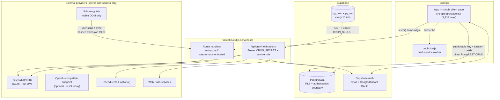
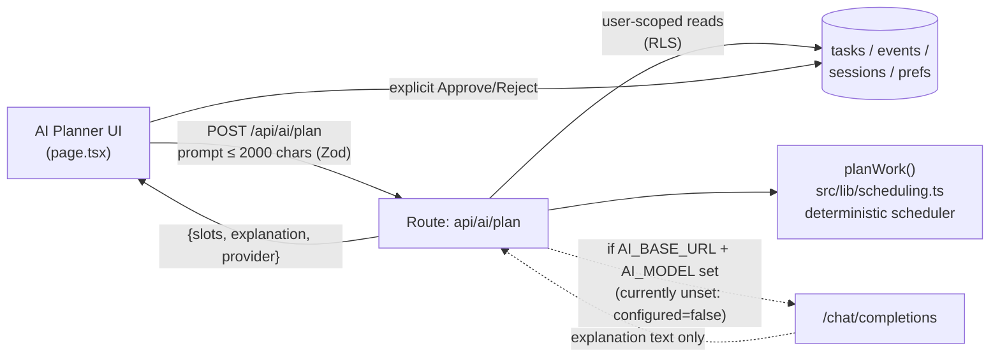
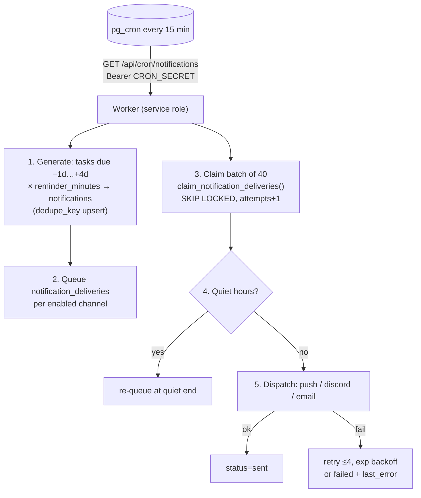

# Architecture

**Status legend:** Implemented · Partially implemented · Broken · Configuration
required · Not verified · Planned · Deprecated. Statements are facts from
source unless explicitly marked _recommendation_.

## System overview

Daymark is a single Next.js 16 App Router application deployed on Vercel, with
Supabase (PostgreSQL + Auth) as the only backend. There is no resident
process: everything server-side is either a route handler invoked by the
browser or by Supabase Cron.

### Server/client boundary

- The entire product UI is **one client component**
  (`src/app/app/page.tsx`, `"use client"`, 16 inline components, ~77
  `useState` hooks). Server components are trivial (`/` redirects to `/app`;
  `layout.tsx` wraps `<Providers>`).
- **There is no `middleware.ts`.** The `/app` auth gate is a client effect
  (`page.tsx:278-297` → `router.replace("/login")`). This is acceptable only
  because **PostgreSQL RLS is the real authorization boundary** — see
  [Security boundaries](#security-boundaries).
- No `loading.tsx`, `not-found.tsx`, or `global-error.tsx`; one root
  `error.tsx` (its `retry` prop matches the installed Next 16 API).

### Supabase clients (three, strictly separated)

| Client       | File                         | Used by                                             | Privilege                                  |
| ------------ | ---------------------------- | --------------------------------------------------- | ------------------------------------------ |
| Browser      | `src/lib/supabase/client.ts` | the workspace page                                  | publishable key; **RLS applies**           |
| Server (SSR) | `src/lib/supabase/server.ts` | all session-authenticated API routes                | publishable key + cookies; **RLS applies** |
| Admin        | `src/lib/supabase/admin.ts`  | **only** `api/account` and `api/cron/notifications` | service role; **bypasses RLS**             |

All three return `null` when env vars are missing, and the UI degrades to
setup instructions instead of showing fake data.

## Data flow

1. Browser login establishes the Supabase session (cookies).
2. Data reads/writes go **directly from the browser to PostgREST**, scoped by
   `auth.uid()` in RLS policies (the workspace page runs a 9-query
   `Promise.all` on load, `page.tsx:196-248`).
3. Privileged or secret operations go through same-origin API routes:
   AI planning (server-held provider key), OAuth dances, bot DMs, push
   subscription storage, account deletion, cron delivery.
4. Deterministic scheduling reads the user's tasks/events/sessions/working
   hours and returns a proposal; **only an explicit user approval inserts
   `scheduled_work_sessions`** (client-side, `page.tsx:1287-1342`).
5. Integration sync (Schoology) writes immutable `original_*` snapshots
   alongside `personal_*` overrides; refreshes never overwrite personal
   fields.
6. Scheduled notification delivery: Supabase Cron → cron route (service role)
   → generate deduplicated notifications → claim deliveries (`FOR UPDATE SKIP
LOCKED`) → dispatch per channel with bounded retries; provider failures are
   recorded in `notification_deliveries.last_error` without affecting the core
   app.

## API boundary

Route handlers are thin authentication shells around inline business logic
(full inventory and auth matrix: [API.md](API.md)). Cross-cutting facts:

- Every route calls `supabase.auth.getUser()` (session) except the cron route
  (shared-secret bearer).
- **No rate limiting, no CSRF tokens** (mitigated by same-origin fetch +
  SameSite cookies) — _recommendation: add rate limiting before public
  signup._
- Only the cron route exports `runtime = "nodejs"`; no `maxDuration` exports.

## Integration architecture

All integration secrets are server-only; stored user tokens are AES-256-GCM
ciphertext (`src/lib/integrations/crypto.ts`). Detail + repair status per
integration: [INTEGRATIONS.md](../operations/INTEGRATIONS.md).

- **Discord:** OAuth2 `identify` linking (state cookie bound to user id) +
  bot DM delivery from the cron worker. Requires `DISCORD_BOT_TOKEN`.
- **Schoology:** Manifest V3 browser extension reads rendered coursework
  from the user's signed-in tab, then syncs through short-lived pairing and
  revocable hashed tokens. Legacy OAuth connect/sync paths are retired; see
  [INTEGRATIONS.md](../operations/INTEGRATIONS.md).
- **AI:** one advisory endpoint (`/api/ai/plan`).
- **Push/email:** delivery channels owned by the cron worker.

## AI architecture (current)

**Status: Implemented (advisory-only) · no provider configured in either live
environment.**

Key properties (verified):

- The **schedule itself is always computed deterministically**; an LLM, when
  configured, only rewrites the human-readable explanation. Its output is
  never parsed into data and never touches the database (system prompt
  forbids inventing commitments: `ai/plan/route.ts:121`).
- On any provider error the route silently falls back to deterministic text.
- Privacy: task titles/due dates/priorities, busy windows, and the user's
  prompt are sent to the configured provider when AI is enabled.
- **Dead schema:** `ai_conversations` and `ai_messages` are created in the
  migration but never read or written — there is no chat UI.
- _Known defect:_ the route does not check `typeof content === "string"`
  before using the model's response (`route.ts:150`) — a non-string payload
  can crash the UI render.

Deep-dive and integration proposals: [INTEGRATIONS.md](../operations/INTEGRATIONS.md)
(§ AI) and [UI_UX_AUDIT.md](../design/UI_UX_AUDIT.md).

## Notification architecture

**Status: Implemented · live delivery Not verified.**

Verified properties and known gaps (details in [TESTING.md](../development/TESTING.md)
and BACKLOG):

- Idempotent generation (dedupe keys + unique `(notification_id, channel)`).
- Quiet-hours deferral honored per user timezone; but **deferral consumes
  retry attempts** (verified: attempts increment at claim; the quiet path
  does not reset them).
- `processing` rows have no reaper — a crashed run can wedge rows forever
  (verified: nothing in `src/` ever resets `processing`).
- `in_app_enabled` is honored by the notification feed and unread badge.
  `daily_summary` and `weekly_summary` remain unused schema fields and are not
  offered as controls; only `kind='task_due'` notifications exist.
- Cron auth uses a constant-time comparison after hashing both values to equal-length digests.

## State management

- Pure local React state in the single workspace component; **no cache layer**
  despite a mounted TanStack Query provider (zero `useQuery`/`useMutation`
  usages — the provider is dead scaffolding).
- Every mutation triggers a full 9-query `reload()`; calendar browsing
  overwrites shared state (see [UI_UX_AUDIT.md](../design/UI_UX_AUDIT.md)
  UI-01).
- Theme: `next-themes` (class strategy, default dark) + DB persistence in
  `user_preferences.theme` + a custom `daymark-theme` window event.

## Deployment model

- Vercel serverless; no resident process or persistent disk.
- **Two live deployments observed (2026-11-17):** `daymark-virid-two.vercel.app`
  (public, cron route reachable) and `daymark-universeftc.vercel.app` (behind
  Vercel Deployment Protection). See
  [VERCEL_ENVIRONMENT_SETUP.md](../operations/VERCEL_ENVIRONMENT_SETUP.md).
- Scheduled work runs in **Supabase Cron** (`pg_cron` + `pg_net` + Vault),
  because Vercel Hobby Cron is once-daily — too coarse for reminder windows.
- Ollama is local-development inference only; a deployed instance cannot
  reach `localhost`.

## Security boundaries

- **Browser keys are publishable and constrained by RLS.** RLS + composite
  ownership constraints (`unique(user_id,id)` + composite FKs,
  migration:142-165) make cross-user attachments impossible even if a policy
  were bypassed.
- Bot tokens, AI keys, VAPID private keys, email keys, and cron secrets are
  server-only. Schoology uses extension tokens hashed server-side; the retired
  OAuth consumer credentials are no longer read.
- OAuth state: httpOnly, path-scoped, 10-minute cookies; Discord state is
  bound to the user id; Schoology state is HMAC-signed. Auth callback `next`
  is allowlisted (no open redirect).
- Full operating rules: [SECURITY.md](../../SECURITY.md).

### Security findings and migration status

The 2026-11-17 audit found `profiles` absent from the migration's RLS loop
(migration:197), leaving `profile_owner` inert in a fresh install, and found
no EXECUTE revoke on the `SECURITY DEFINER` notification claim function
(migration:176-185, grants:204-205 only cover tables). Migration
`0002_security_hardening.sql` and an explicit Settings owner filter are now
implemented in the working tree. Both migrations and the rollback-only
isolation test passed on disposable DaymarkTest on 2026-11-19. Migration 0002
was applied to production with explicit approval; post-migration metadata
confirms profiles RLS and its owner policy are active and
PUBLIC/anon/authenticated cannot execute the notification claim function.
See [DATABASE.md](DATABASE.md) for the exact code and verification status.

Other findings remain open: no CSP header and the cron secret comparison is
not constant-time (see SECURITY.md and BACKLOG.md).

## Known architectural limits

- **Large workspace module:** the client page has been reduced and shared
  view/primitives live under `src/components/`, but data loading and much
  application state remain in the page; further feature extraction is open.
- **Thin service boundaries:** the sync worker (241 lines) and notification
  worker (313 lines) live inside route handlers; dedupe/retry/quiet-hours
  rules are untestable by the current unit suite.
- **Hand-written types duplicate the schema** (no generated Supabase types);
  `as T[]` casts throughout both client and workers.
- Integration delivery remains **Not verified** end-to-end; a visual setup
  state is not evidence of provider delivery — record provider test
  date/account/environment per [TESTING.md](../development/TESTING.md).
