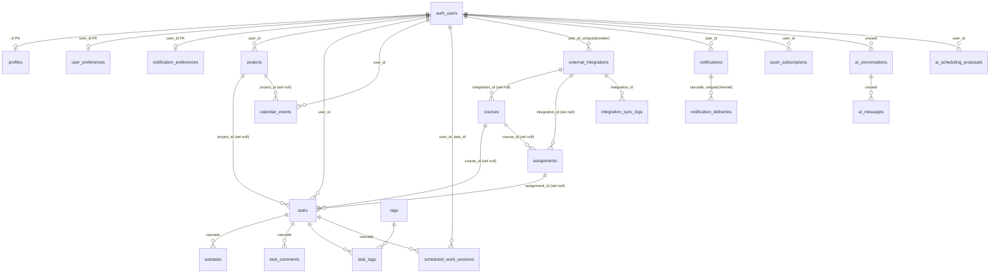

# Database

PostgreSQL schema on Supabase. **The SQL migrations are the source of truth**
for everything in this document; when this file and the SQL migration files
in [`supabase/migrations/`](../../supabase/migrations/) disagree, the
migrations win and this file is stale — report it.

**Migration inventory (2026-11-19):** `0001_daymark.sql` defines the initial
schema and `0002_security_hardening.sql` adds the profiles RLS enablement and
notification RPC grants. It was applied to the disposable `DaymarkTest`
project (`nctorjcauabycyzdmxxy`) and production Daymark
(`iytnacmrgfaykxdiurzw`) on 2026-11-19. The rollback-only isolation test
passed on DaymarkTest. Post-migration production metadata confirms RLS and
function ACLs match the intended settings. Non-schema SQL also exists
in `supabase/cron/notifications.sql` (cron job) and
`supabase/tests/rls_isolation.sql` (manual rollback-only test). There is no
`supabase/config.toml`; apply via the Supabase SQL editor (see
[DEPLOYMENT.md](../operations/DEPLOYMENT.md)).

## Entity overview

## Tables (21)

All primary keys are UUID; every user-owned table has `user_id` →
`auth.users(id) ON DELETE CASCADE` (account deletion cascades).

| Group | Tables | Purpose |
| --- | --- | --- |
| Account | `profiles`, `user_preferences` | display name; timezone/theme/week-start/workday preferences |
| Work | `projects`, `tasks`, `subtasks`, `task_comments`, `tags`, `task_tags` | tasks have `status` (backlog/todo/in_progress/in_review/completed enums), `priority`, estimates, `source` (manual/assignment/ai) |
| Calendar | `calendar_events`, `scheduled_work_sessions` | events with timezone/recurrence fields; approved planner blocks (`status` planned/done/skipped) |
| Coursework | `courses`, `assignments` | sync flags on courses; assignments carry immutable `original_*` snapshots **and** independent `personal_*` overrides |
| Integrations | `external_integrations`, `integration_sync_logs` | per `(user_id, provider)` connection state + encrypted token blob + sync history |
| Notifications | `notification_preferences`, `notifications`, `notification_deliveries`, `push_subscriptions` | channel prefs, in-app history, per-channel delivery queue, web-push endpoints |
| AI | `ai_conversations`, `ai_messages`, `ai_scheduling_proposals` | **first two are dead schema** (never referenced in `src/`); proposals are written on approve/reject |

Column-level detail is intentionally not duplicated here — read the
migration (205 lines).

## Relationships and integrity design

- Ordinary FKs: `ON DELETE SET NULL` for optional links (task→project,
  task→course/assignment, integration→courses/assignments), `CASCADE` for
  owned children (subtasks, comments, deliveries, messages).
- **Composite ownership constraints (migration:142-165):** `UNIQUE(user_id, id)`
  on seven parent tables plus composite FKs such as
  `subtasks(user_id, task_id) → tasks(user_id, id)`. This makes it
  *impossible to attach a row to another user's parent* even if RLS were
  bypassed. Keep this pattern for every new parent/child pair.
- Notable columns: `scheduled_work_sessions.proposal_id` has **no FK**;
  `push_subscriptions.endpoint` is globally unique; `notifications.dedupe_key`
  unique per user; `calendar_events.external_id` unique per user.
- **No CHECK constraints** on `notification_deliveries.channel/status`,
  `notifications.kind`, or `external_integrations.status` (free-form text).

## Indexes (explicit)

| Index | Serves |
| --- | --- |
| `tasks(user_id, due_at) WHERE status <> 'completed'` | deadline queries |
| `tasks(user_id, status, updated_at DESC)` | board/list |
| `calendar_events(user_id, starts_at, ends_at)` | calendar ranges |
| `scheduled_work_sessions(user_id, starts_at, ends_at)` | planner ranges |
| `assignments(user_id, coalesce(personal_due_at, original_due_at))` | assignment due lists |
| `notifications(user_id, created_at DESC) WHERE read_at IS NULL` | unread badge |
| `notification_deliveries(status, scheduled_for) WHERE status IN ('queued','retry')` | cron claim |
| `integration_sync_logs(user_id, started_at DESC)` | sync history |

*Missing indexes identified by audit (recommendation backlog):*
`push_subscriptions(user_id)` (queried per delivery), `tasks(user_id,
assignment_id)` (queried per assignment during sync), `subtasks(task_id)`,
`task_comments(task_id)`.

## RLS and ownership

- RLS is enabled by a `DO` loop over a **20-table list** (migration:196-201)
  creating policy `owner_all`
  (`USING`/`WITH CHECK user_id = (select auth.uid())`), plus policy `profile_owner`
  on `profiles` (migration:202).
- `0001_daymark.sql` omits `profiles` from its RLS loop. In DaymarkTest,
  migration `0002_security_hardening.sql` enabled RLS and the rollback-only
  two-user test verified the existing owner policy blocks cross-user profile
  reads and writes. Read-only production
  metadata on 2026-11-19 showed RLS enabled (`relrowsecurity=true`,
  `relforcerowsecurity=false`) and the existing `profile_owner` policy active
  for `{public}`, with both `USING` and `WITH CHECK` scoped to
  `id = (select auth.uid())`. Migration `0002_security_hardening.sql` makes
  this state reproducible. The isolation SQL passed in DaymarkTest; production
  metadata after migration confirms RLS and the policy are active, but the
  cross-user test itself was not run against production. The Settings profile read now also filters
  by the authenticated user's ID in `src/app/app/page.tsx`.
- Production grants `anon`, `authenticated`, and `service_role` SQL
  SELECT/INSERT/UPDATE/DELETE on profiles. `anon` and `authenticated` do not
  bypass RLS; `service_role` does. The owner policy remains the authorization
  boundary for browser roles.
- All ownership policies are permissive with no `TO` clause; `auth.uid()` is
  NULL for `anon`, so anon sees no profile rows under `profile_owner`.
- `supabase/tests/rls_isolation.sql` now checks profile SELECT/INSERT/UPDATE/
  DELETE boundaries, project and child-row isolation, composite-FK ownership,
  bootstrap behavior, and function ACLs. It passed in DaymarkTest on
  2026-11-19; see [TESTING.md](../development/TESTING.md).

## Functions and triggers

| Object | Definition | Notes |
| --- | --- | --- |
| `claim_notification_deliveries(batch_size)` | `SECURITY DEFINER`, `search_path=''`, `FOR UPDATE SKIP LOCKED`, caps batch at 100, sets `processing` + `attempts+1` (migration:176-185); `0002_security_hardening.sql` revokes PUBLIC/anon/authenticated and grants `service_role` | DaymarkTest and production metadata on 2026-11-19 confirmed anon/authenticated/PUBLIC denied and service_role allowed; production owner is `postgres` and `search_path=""`. Worker code uses its service-role client (`src/app/api/cron/notifications/route.ts:139-142`), so its required EXECUTE permission is preserved. A post-migration live delivery was not exercised. |
| `bootstrap_profile()` trigger | `AFTER INSERT ON auth.users` → creates `profiles`, `user_preferences`, `notification_preferences` (migration:187-194) | the only trigger |

No views exist in the schema.

## Dead or unused schema (verified 2026-11-17)

No code reference exists for: `tags`, `task_tags` (no UI), `ai_conversations`,
`ai_messages` (no chat surface); stored-but-unread columns: `in_app_enabled`,
`daily_summary`, `weekly_summary` (worker ignores them), `week_starts_on`
(UI saves it; all computations hardcode Monday), `tasks.completed_at`,
`tasks.recurrence`, `calendar_events.recurrence_rule/location/category`,
`projects.start_date/icon`, `user_preferences.date_format/time_format/
default_calendar_view`, `assignments.ignored_at`/`personal_completed`
(read but never settable). These are candidates for wiring up or removing —
see [BACKLOG.md](../product/BACKLOG.md).

## Secret material

`external_integrations.encrypted_credentials` contains only AES-256-GCM
ciphertext + nonce/tag envelope; `INTEGRATION_ENCRYPTION_KEY` must be a random
32-byte key. Rotating it requires a decrypt/re-encrypt migration while the
old key remains available. Never return this column in app API responses
(no route currently does — verified).

## Ownership

- Schema changes: migration-only, additive where possible, reviewed against
  this document in the same change (see [AGENTS.md](../../AGENTS.md)).
- The project owner approves any change to RLS policy structure, cascading
  deletes, or encryption handling.
